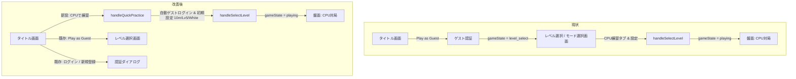

# タスク計画: タイトル画面「CPUで練習 (Practice vs CPU)」ダイレクト導線の追加

## 1. 目的と背景
- **背景**: ユーザーレビューにおいて「CPU練習への入口が見つけにくい」「ゲストログインしてからモード選択に行かないとCPU対戦が見当たらない」という課題が指摘されていた。
- **目的**: タイトル画面からワンタップで即座にCPU練習対局（10分・先手・難易度5）を開始できる最短導線を追加し、初心者や新規プレイヤーのオンボーディング体験を飛躍的に向上させる。

## 2. 影響範囲と状態遷移

### 影響ファイル
1. `src/locales/dict.ts` / `src/locales/additional.ts`: 12言語のボタンラベル（`practiceVsCpu` 等）
2. `src/components/TitleScreen.tsx`:
   - `TitleScreenProps` に `onQuickPractice?: () => void` を追加
   - アクション領域に「CPUで練習 (Practice vs CPU)」ボタンを配置
   - アクセシビリティ・フォーカス管理・モバイル（320px〜）レスポンシブ対応
3. `src/components/title-screen.css`:
   - 新規ボタン `.title-practice-direct`（または既存 `.title-play` と調和するスタイル）
4. `src/app/page.tsx`:
   - `TitleScreen` に `onQuickPractice` ハンドラーを渡す
   - 未ログイン時はゲストユーザーを自動生成し、`handleSelectLevel('10m', 5, 'white')` を実行して `gameState = 'playing'` へ直行

## 3. 実装手順
- [ ] Step 1: ブランチ作成 (`feat/direct-cpu-practice-20261014`)
- [ ] Step 2: 12言語辞書へのラベル追加 (`practiceVsCpu`)
- [ ] Step 3: `src/components/TitleScreen.tsx` と `title-screen.css` の改修
- [ ] Step 4: `src/app/page.tsx` でのクイック対局接続
- [ ] Step 5: `npm run typecheck` による型安全性検証
- [ ] Step 6: 単体テスト実行 (`npm test -- TitleScreen`)
- [ ] Step 7: ブラウザ・小画面（320px / 375px / 1280px）および多言語（ja, en, de, ta）表示確認
- [ ] Step 8: コミット & 報告（確認したこと・未確認のこと・確認用URL）

## 4. 品質保証基準
- 12言語対応（en, ja, zh, ru, fr, de, es, tr, pl, hi, pt, ta）
- モバイル最小幅（320px〜）および文字拡大200%でレイアウト崩れなし
- キーボード（Enter / Space / Tab）操作対応
- 既存の「Play as Guest」「ログイン」「新規登録」「ルール」「100マス閲覧」導線を破壊しない
