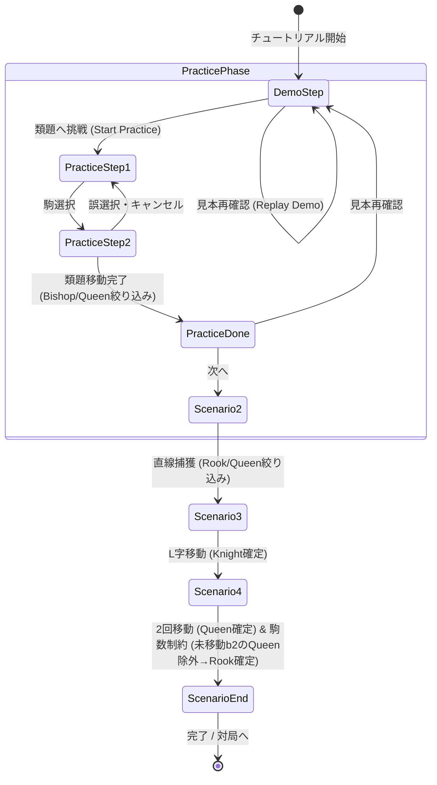

# Q-Gambit 「推理の見本 → 類題」チュートリアル導入計画

## 概要
オンボーディング体験の向上として、インタラクティブチュートリアル（`InteractiveTutorial.tsx`）に「推理の見本（実演） → 類題（プレイヤーによる実践）」の流れを導入し、駒の動きから正体が絞り込まれる量子チェス特有のロジックを直感的に理解できるようにする。

## 状態遷移と影響範囲 (Mermaid)

## 影響範囲
1. `src/components/InteractiveTutorial.tsx`:
   - 「見本（実演）」状態と「類題（実践）」状態の追加
   - 「見本を再確認」「やり直し (Reset)」ボタン
   - 誤操作時のフィードバックと復帰処理
   - 未移動駒のQueen枠/駒数制約の強調ハイライト（b1とb2の同時ハイライト/解説）
   - モーション軽減 (`prefers-reduced-motion`) 対応
   - Escape / 閉じる / フォーカス復帰
2. `src/locales/rulesDict.ts`:
   - 主要言語（ja, en, zh, ru, fr, de, es）のチュートリアル見本・類題文言、駒数制約解説の更新
3. `src/locales/additionalTutorial.ts`:
   - 追加言語（tr, pl, pt, hi, ta）の対応
4. 単体テスト & 自動UI検証:
   - `InteractiveTutorial` のシナリオ検証テスト
   - Playwright による見本再生、類題操作、復帰、12言語・小画面（320px〜）・文字200%検証

## 作業ステップ
- [ ] 1. `task.md` の作成（本ファイル）
- [ ] 2. 辞書データ（`rulesDict.ts`, `additionalTutorial.ts`）に「見本・類題・制約解説・ボタンラベル」を12言語分定義
- [ ] 3. `InteractiveTutorial.tsx` の機能拡張（見本実演、類題操作、やり直し、再確認、駒枠強調、アクセシビリティ）
- [ ] 4. 単体テスト作成 & 型チェック（`npm run typecheck`, `npm test`）
- [ ] 5. Playwright による自動UIテスト作成 & 実行（PC 1280px, モバイル 375px, 極小 320px, 文字200%, 多言語）
- [ ] 6. コミット & 本番デプロイ（Cloudflare Pages）と公開稼働確認
- [ ] 7. 監督・受入報告の作成
